# Shopify Connector — Setup Guide for Consultants

How to connect a Shopify store to Business Central and configure the Shop card for products, inventory,
order-to-cash and B2B.

| | |
|---|---|
| **Audience** | Consultants and implementers who know Business Central |
| **Connector version** | Shopify Connector 28.x (field captions from `App/src/Base/Pages/ShpfyShopCard.Page.al`) |
| **Worked example** | BC sandbox `Sandbox`, company ORQA D.O.O. → Shopify dev store `croatia-test.myshopify.com`, shop code `CROATIA` |
| **Ticket** | Azure DevOps work item 112 |

> **About the screenshots.** They were taken in the BC sandbox on 2026-10-26, **before the store was
> connected**. The values you see are the connector's defaults, not the values this guide recommends.
> Pink numbered badges match the numbered rows in the table under each screenshot.

## Order of work

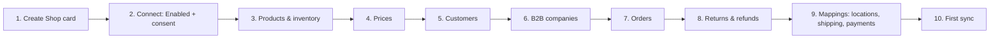

Before you start, have these ready in Business Central: an **item template**, a **customer template**, a
**G/L account for shipping charges**, and the **locations** that hold stock you sell on Shopify.

---

## 1. Create the Shop card

Search for **Shopify Shops** and choose **New**.

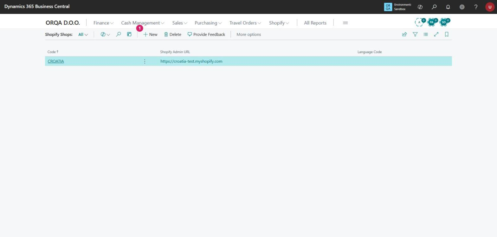

| # | Action |
|---|---|
| 1 | **New** opens an empty Shopify Shop Card. |

## 2. Connect the store

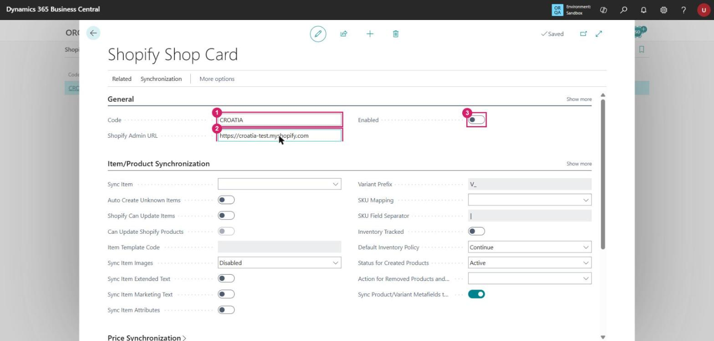

| # | Field | What to enter |
|---|---|---|
| 1 | **Code** | A short code for the shop, for example `CROATIA`. |
| 2 | **Shopify Admin URL** | The store's `*.myshopify.com` address, for example `https://croatia-test.myshopify.com`. The connector corrects the URL format when you leave the field. |
| 3 | **Enabled** | Turn it on. Business Central first asks for **privacy consent** (data leaves BC for Shopify). After that it requests an access token, and Shopify shows the app-install screen. |

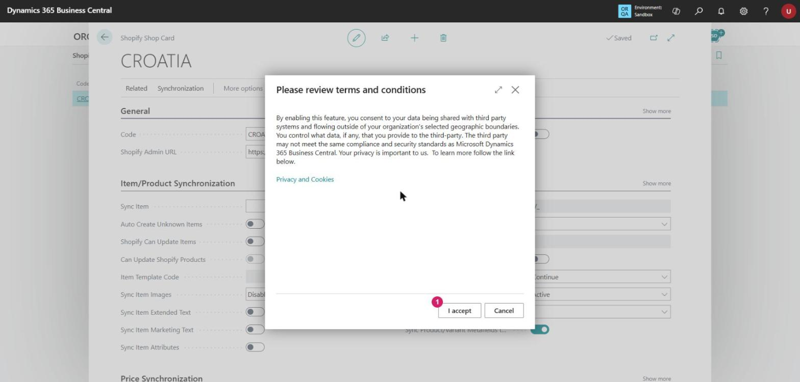

| # | Action |
|---|---|
| 1 | **I accept** confirms the consent. *Cancel* leaves **Enabled** off. |

The person who owns the store accepts both the consent dialog and the Shopify install screen.

**In a sandbox, HTTP calls must be allowed first.** BC blocks outbound HTTP calls from every extension in a
non-production environment. Turning on **Enabled** then fails with *"Shopify connector is not allowed to make
HTTP requests when running in a non-production environment."*

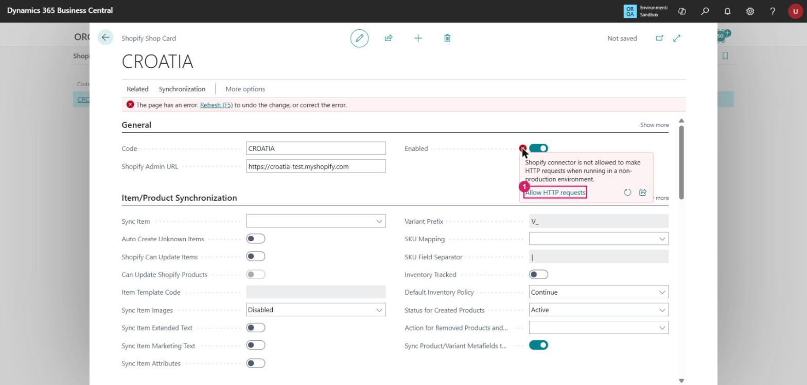

| # | Action |
|---|---|
| 1 | Select the red error icon next to **Enabled**, then choose **Allow HTTP requests**. The same setting is in **Extension Management → Shopify Connector → Configure → Allow HttpClient Requests** ([Microsoft Learn: Troubleshooting](https://learn.microsoft.com/dynamics365/business-central/shopify/troubleshoot#verify-and-enable-permissions-to-make-http-requests-in-a-nonproduction-environment)). |

**Enabled** goes back to off. Turn it on again: the consent dialog appears again, then the Shopify
install pop-up. The browser must allow pop-ups from `businesscentral.dynamics.com`.

**Check the connection:** under **General → Show more**, **Has access token** must be on.

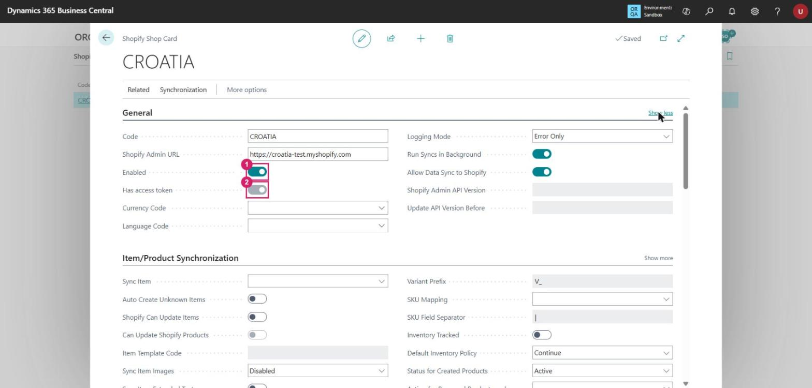

| # | Field | Connected state |
|---|---|---|
| 1 | **Enabled** | On |
| 2 | **Has access token** | On (read-only) |
 **Request Access**
gets a new token, and **Test Connection** checks that the token works. Both actions are on the card.

## 3. Products and inventory

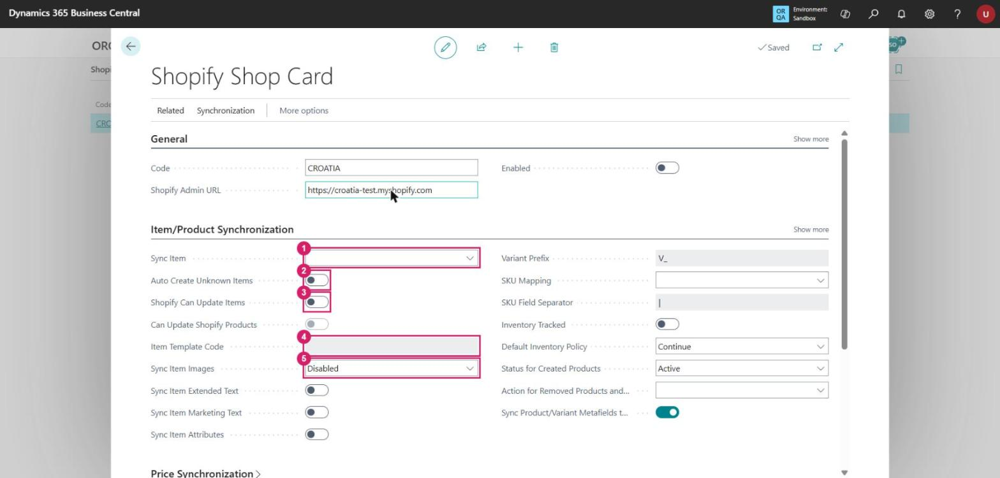

| # | Field | What it does | CROATIA |
|---|---|---|---|
| 1 | **Sync Item** | Direction of item sync: *To Shopify* (BC is the source) or *From Shopify* (Shopify is the source). | **From Shopify** |
| 2 | **Auto Create Unknown Items** | Creates an item in BC when a Shopify product has no matching item. | On, if Shopify is the product master |
| 3 | **Shopify Can Update Items** | Lets Shopify overwrite BC items during the sync. It cannot be on together with *Can Update Shopify Products*: turning one on turns the other off. | On, for *From Shopify* |
| 4 | **Item Template Code** | Template used for items created by row 2. The field is marked mandatory. | Your item template |
| 5 | **Sync Item Images** | *Disabled*, *To Shopify* or *From Shopify*. | *From Shopify* |

On the right-hand side of the same section:

- **SKU Mapping** decides how a Shopify SKU matches a BC item or variant.
- **Inventory Tracked** lets BC manage stock in Shopify.
- **Default Inventory Policy** is *Continue* (stock may go negative) or *Deny* (it may not).

**Inventory by location:** choose **Related → Locations** (see step 9) and fill in **Default Location Code**
and **Location Filter**. The location filter sets which BC locations count towards the stock sent to
Shopify. **Stock Calculation** sets how that stock is calculated.

## 4. Prices

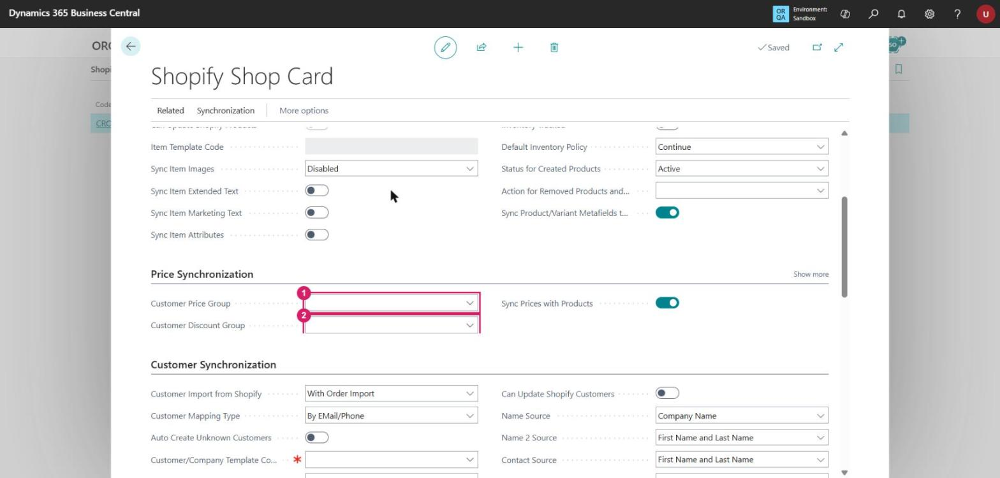

| # | Field | What it does |
|---|---|---|
| 1 | **Customer Price Group** | Price group used to calculate the prices sent to Shopify. |
| 2 | **Customer Discount Group** | Discount group used in the same calculation. |
| — | **Sync Prices with Products** | Sends prices together with the product sync. |

With *Sync Item = From Shopify*, prices are maintained in Shopify, and these fields matter only if BC pushes
prices back.

## 5. Customers

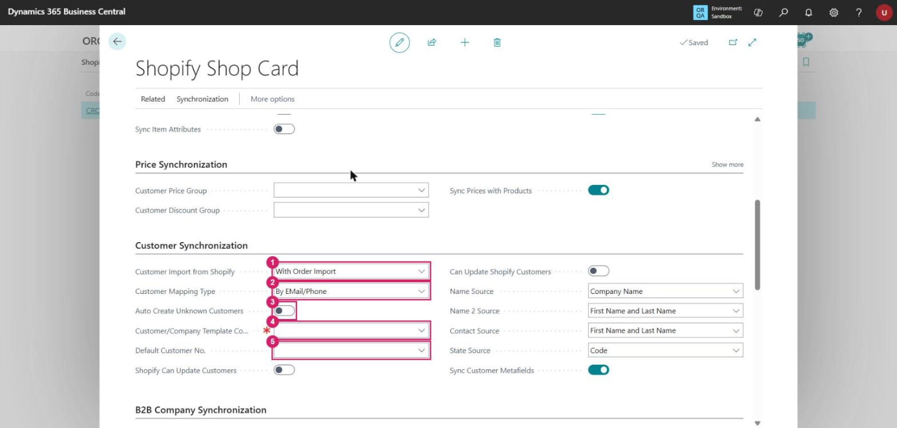

| # | Field | What it does |
|---|---|---|
| 1 | **Customer Import from Shopify** | When customers are imported, for example *With Order Import*. With *None*, an order whose customer has no mapping uses the default customer (row 5). |
| 2 | **Customer Mapping Type** | How a Shopify customer is matched to a BC customer, for example *By EMail/Phone*. |
| 3 | **Auto Create Unknown Customers** | Creates a BC customer when no match is found. |
| 4 | **Customer/Company Template Code** | Template for created customers and companies. **Mandatory** (red asterisk). |
| 5 | **Default Customer No.** | The customer used when you do not create one BC customer per web-shop user. |

**Customer Setup by Country/Region** (step 9) can give each country its own template.

## 6. B2B companies

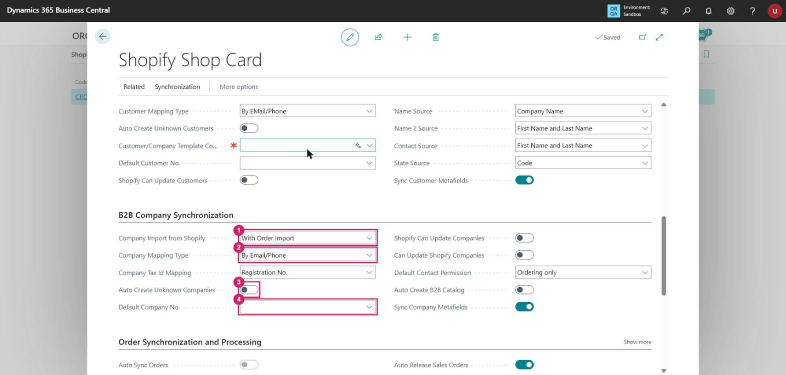

| # | Field | What it does |
|---|---|---|
| 1 | **Company Import from Shopify** | When Shopify B2B companies are imported. |
| 2 | **Company Mapping Type** | How a Shopify company is matched to a BC customer. |
| 3 | **Auto Create Unknown Companies** | Creates a BC customer for an unknown company. |
| 4 | **Default Company No.** | The customer used when you do not create one per B2B company. |
| — | **Auto Create B2B Catalog** | Creates a catalog automatically for each new company. |

Catalog pricing is managed under **Related → B2B Catalogs**.

## 7. Orders

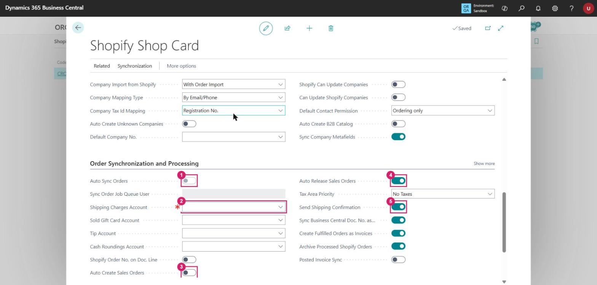

| # | Field | What it does |
|---|---|---|
| 1 | **Auto Sync Orders** | Shopify notifies BC when an order is created, and BC schedules *Sync Orders from Shopify* on the job queue. The job runs as the user who turns this on. It can be changed only when the shop is enabled. |
| 2 | **Shipping Charges Account** | G/L account for shipping cost lines. **Mandatory.** |
| 3 | **Auto Create Sales Orders** | Creates BC sales documents from imported Shopify orders. |
| 4 | **Auto Release Sales Orders** | Releases the sales order after it is created. |
| 5 | **Send Shipping Confirmation** | Notifies the customer when the shipment is synced to Shopify. |

Also set **Sold Gift Card Account**, **Tip Account** and **Cash Roundings Account** if the store uses gift
cards, tips or cash rounding.

## 8. Returns and refunds

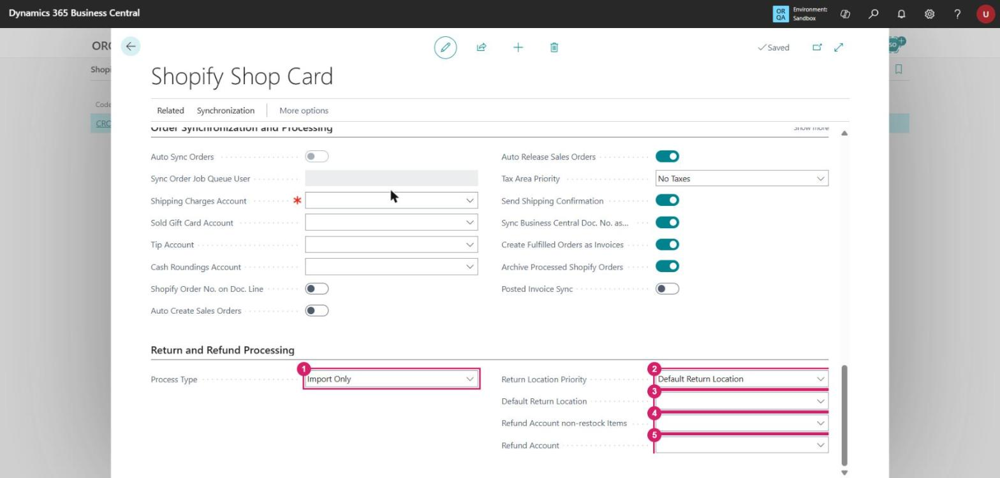

| # | Field | What it does |
|---|---|---|
| 1 | **Process Type** | *Import Only* by default. *Auto Create Credit Memo* requires **Auto Create Sales Orders** (step 7) to be on, and the connector raises an error otherwise. |
| 2 | **Return Location Priority** | Where returned items go: *Default Return Location*, or *Original -> Default Location* (the original location first, then the default one). |
| 3 | **Default Return Location** | Location used for returned items. |
| 4 | **Refund Account non-restock Items** | G/L account for refunds of items that are not restocked. |
| 5 | **Refund Account** | G/L account for other refund lines. |

## 9. Mappings

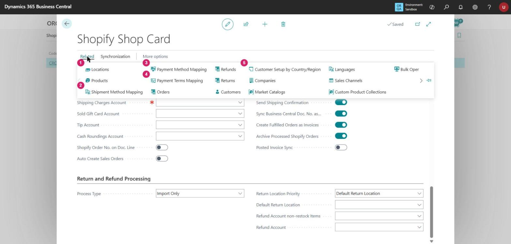

| # | Page | What to map |
|---|---|---|
| 1 | **Locations** | Shopify locations ↔ BC locations (default location, location filter, stock calculation). Fill it after the first connection: the connector reads the locations from Shopify. |
| 2 | **Shipment Method Mapping** | Shopify shipping methods ↔ BC shipment methods and shipping agents. |
| 3 | **Payment Method Mapping** | Shopify payment gateways ↔ BC payment methods. |
| 4 | **Payment Terms Mapping** | Shopify payment terms ↔ BC payment terms. |
| 5 | **Customer Setup by Country/Region** | Customer template per country. |

## 10. First synchronization

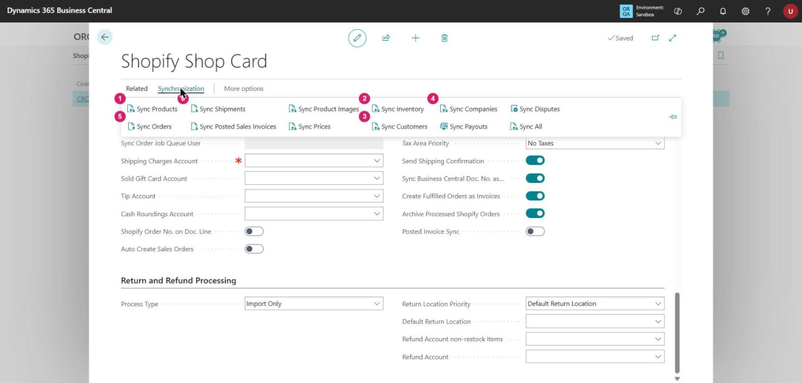

Run them in this order, so that each sync finds the records it depends on:

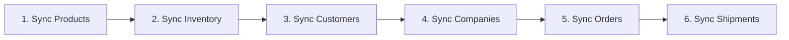

| # | Action | What it does |
|---|---|---|
| 1 | **Sync Products** | Imports or exports products, in the direction set in step 3. |
| 2 | **Sync Inventory** | Updates stock levels. |
| 3 | **Sync Customers** | Imports or exports customers. |
| 4 | **Sync Companies** | B2B companies. |
| 5 | **Sync Orders** | Imports Shopify orders. |
| 6 | **Sync Shipments** | Synchronizes shipments to Shopify. |

**Allow Background Syncs** (under **General → Show more**) runs syncs in the background. Turn it off while
you test, to see progress and detailed errors.

---

## Still to capture

These screens need the connected store, so they are not in this version of the guide:

- the Shopify app-install screen (step 2);
- the Locations page filled with the store's Shopify locations (step 9);
- the result of the first sync (step 10).
