# Shopify Connector — Setup Guide for Consultants

How to connect a Shopify store to Business Central and configure the Shop card for products, inventory,
order-to-cash and B2B.

| | |
|---|---|
| **Audience** | Consultants and implementers who know Business Central |
| **Connector version** | Shopify Connector 28.x (field captions from `App/src/Base/Pages/ShpfyShopCard.Page.al`) |
| **Worked example** | BC sandbox `Sandbox`, company ORQA D.O.O. → Shopify dev store `croatia-test.myshopify.com`, shop code `CROATIA` |
| **Ticket** | Azure DevOps work item 112 |

> **About the screenshots.** They were taken in the BC sandbox on 2026-10-26. Steps 1–10 show the
> connector's **defaults**, captured before the store was connected. **Part 2** shows the values actually
> set for the worked example, and **Part 3** shows a test order going from Shopify into BC. Pink numbered
> badges match the numbered rows in the table under each screenshot. All customer data is invented.

## Order of work

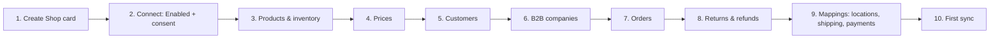

Before you start, have these ready in Business Central: an **item template**, a **customer template**, a
**G/L account for shipping charges**, and the **locations** that hold stock you sell on Shopify.

---

## 1. Create the Shop card

Search for **Shopify Shops** and choose **New**.

| # | Action |
|---|---|
| 1 | **New** opens an empty Shopify Shop Card. |

## 2. Connect the store

| # | Field | What to enter |
|---|---|---|
| 1 | **Code** | A short code for the shop, for example `CROATIA`. |
| 2 | **Shopify Admin URL** | The store's `*.myshopify.com` address, for example `https://croatia-test.myshopify.com`. The connector corrects the URL format when you leave the field. |
| 3 | **Enabled** | Turn it on. Business Central first asks for **privacy consent** (data leaves BC for Shopify). After that it requests an access token, and Shopify shows the app-install screen. |

| # | Action |
|---|---|
| 1 | **I accept** confirms the consent. *Cancel* leaves **Enabled** off. |

The person who owns the store accepts both the consent dialog and the Shopify install screen.

**In a sandbox, HTTP calls must be allowed first.** BC blocks outbound HTTP calls from every extension in a
non-production environment. Turning on **Enabled** then fails with *"Shopify connector is not allowed to make
HTTP requests when running in a non-production environment."*

| # | Action |
|---|---|
| 1 | Select the red error icon next to **Enabled**, then choose **Allow HTTP requests**. The same setting is in **Extension Management → Shopify Connector → Configure → Allow HttpClient Requests** ([Microsoft Learn: Troubleshooting](https://learn.microsoft.com/dynamics365/business-central/shopify/troubleshoot#verify-and-enable-permissions-to-make-http-requests-in-a-nonproduction-environment)). |

**Enabled** goes back to off. Turn it on again: the consent dialog appears again, then the Shopify
install pop-up. The browser must allow pop-ups from `businesscentral.dynamics.com`.

**Check the connection:** under **General → Show more**, **Has access token** must be on.

| # | Field | Connected state |
|---|---|---|
| 1 | **Enabled** | On |
| 2 | **Has access token** | On (read-only) |

**Request Access** gets a new token, and **Test Connection** checks that the token works. Both actions are on the card.

## 3. Products and inventory

| # | Field | What it does | CROATIA |
|---|---|---|---|
| 1 | **Sync Item** | Direction of item sync: *To Shopify* (BC is the source) or *From Shopify* (Shopify is the source). | **From Shopify** |
| 2 | **Auto Create Unknown Items** | Creates an item in BC when a Shopify product has no matching item. | On, if Shopify is the product master |
| 3 | **Shopify Can Update Items** | Lets Shopify overwrite BC items during the sync. It cannot be on together with *Can Update Shopify Products*: turning one on turns the other off. | On, for *From Shopify* |
| 4 | **Item Template Code** | Template used for items created by row 2. The field is marked mandatory. | Your item template |
| 5 | **Sync Item Images** | *Disabled*, *To Shopify* or *From Shopify*. | *From Shopify* |

On the right-hand side of the same section:

- **SKU Mapping** decides how a Shopify SKU matches a BC item or variant.
- **Inventory Tracked** lets BC manage stock in Shopify.
- **Default Inventory Policy** is *Continue* (stock may go negative) or *Deny* (it may not).

**Inventory by location:** choose **Related → Locations** (see step 9) and fill in **Default Location Code**
and **Location Filter**. The location filter sets which BC locations count towards the stock sent to
Shopify. **Stock Calculation** sets how that stock is calculated.

## 4. Prices

| # | Field | What it does |
|---|---|---|
| 1 | **Customer Price Group** | Price group used to calculate the prices sent to Shopify. |
| 2 | **Customer Discount Group** | Discount group used in the same calculation. |
| — | **Sync Prices with Products** | Sends prices together with the product sync. |

With *Sync Item = From Shopify*, prices are maintained in Shopify, and these fields matter only if BC pushes
prices back.

## 5. Customers

| # | Field | What it does |
|---|---|---|
| 1 | **Customer Import from Shopify** | When customers are imported, for example *With Order Import*. With *None*, an order whose customer has no mapping uses the default customer (row 5). |
| 2 | **Customer Mapping Type** | How a Shopify customer is matched to a BC customer, for example *By EMail/Phone*. |
| 3 | **Auto Create Unknown Customers** | Creates a BC customer when no match is found. |
| 4 | **Customer/Company Template Code** | Template for created customers and companies. **Mandatory** (red asterisk). |
| 5 | **Default Customer No.** | The customer used when you do not create one BC customer per web-shop user. |

**Customer Setup by Country/Region** (step 9) can give each country its own template.

## 6. B2B companies

| # | Field | What it does |
|---|---|---|
| 1 | **Company Import from Shopify** | When Shopify B2B companies are imported. |
| 2 | **Company Mapping Type** | How a Shopify company is matched to a BC customer. |
| 3 | **Auto Create Unknown Companies** | Creates a BC customer for an unknown company. |
| 4 | **Default Company No.** | The customer used when you do not create one per B2B company. |
| — | **Auto Create B2B Catalog** | Creates a catalog automatically for each new company. |

Catalog pricing is managed under **Related → B2B Catalogs**.

## 7. Orders

| # | Field | What it does |
|---|---|---|
| 1 | **Auto Sync Orders** | Shopify notifies BC when an order is created, and BC schedules *Sync Orders from Shopify* on the job queue. The job runs as the user who turns this on. It can be changed only when the shop is enabled. |
| 2 | **Shipping Charges Account** | G/L account for shipping cost lines. **Mandatory.** |
| 3 | **Auto Create Sales Orders** | Creates BC sales documents from imported Shopify orders. |
| 4 | **Auto Release Sales Orders** | Releases the sales order after it is created. |
| 5 | **Send Shipping Confirmation** | Notifies the customer when the shipment is synced to Shopify. |

Also set **Sold Gift Card Account**, **Tip Account** and **Cash Roundings Account** if the store uses gift
cards, tips or cash rounding.

## 8. Returns and refunds

| # | Field | What it does |
|---|---|---|
| 1 | **Process Type** | *Import Only* by default. *Auto Create Credit Memo* requires **Auto Create Sales Orders** (step 7) to be on, and the connector raises an error otherwise. |
| 2 | **Return Location Priority** | Where returned items go: *Default Return Location*, or *Original -> Default Location* (the original location first, then the default one). |
| 3 | **Default Return Location** | Location used for returned items. |
| 4 | **Refund Account non-restock Items** | G/L account for refunds of items that are not restocked. |
| 5 | **Refund Account** | G/L account for other refund lines. |

## 9. Mappings

| # | Page | What to map |
|---|---|---|
| 1 | **Locations** | Shopify locations ↔ BC locations (default location, location filter, stock calculation). Fill it after the first connection: the connector reads the locations from Shopify. |
| 2 | **Shipment Method Mapping** | Shopify shipping methods ↔ BC shipment methods and shipping agents. |
| 3 | **Payment Method Mapping** | Shopify payment gateways ↔ BC payment methods. |
| 4 | **Payment Terms Mapping** | Shopify payment terms ↔ BC payment terms. |
| 5 | **Customer Setup by Country/Region** | Customer template per country. |

## 10. First synchronization

Run them in this order, so that each sync finds the records it depends on:

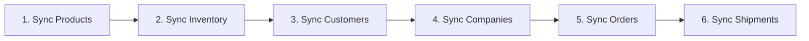

| # | Action | What it does |
|---|---|---|
| 1 | **Sync Products** | Imports or exports products, in the direction set in step 3. |
| 2 | **Sync Inventory** | Updates stock levels. |
| 3 | **Sync Customers** | Imports or exports customers. |
| 4 | **Sync Companies** | B2B companies. |
| 5 | **Sync Orders** | Imports Shopify orders. |
| 6 | **Sync Shipments** | Synchronizes shipments to Shopify. |

**Allow Background Syncs** (under **General → Show more**) runs syncs in the background. Turn it off while
you test, to see progress and detailed errors.

---

---

# Part 2 — First-time setup: the worked example

These are the values set on shop `CROATIA` in the ORQA sandbox, with Shopify as the product master. Use them
as a starting point and replace the codes with your company's own.

| Area | Field | Value used | Why |
|---|---|---|---|
| Items | Sync Item | From Shopify | Products are maintained in Shopify |
| Items | Auto Create Unknown Items | On | First import creates the items |
| Items | Shopify Can Update Items | On | Later changes in Shopify flow to BC |
| Items | Item Template Code | `GOTOV PROIZVOD` | The company's finished-goods template |
| Items | Sync Item Images | From Shopify | Images come with the products |
| Customers | Auto Create Unknown Customers | On | Web-shop buyers become BC customers |
| Customers | Customer/Company Template Code | `K-DOM` | Domestic customers |
| Orders | Shipping Charges Account | `41000` | **Sandbox test only.** It is an expense account; use a revenue account in production |
| Orders | Auto Create Sales Orders | On | Imported orders become sales orders |
| Locations | Default Location Code / Location Filter on *Shop location* | `WH500C` | Central finished-goods warehouse |
| General | Run Syncs in Background | Off | Shows sync results directly while testing |

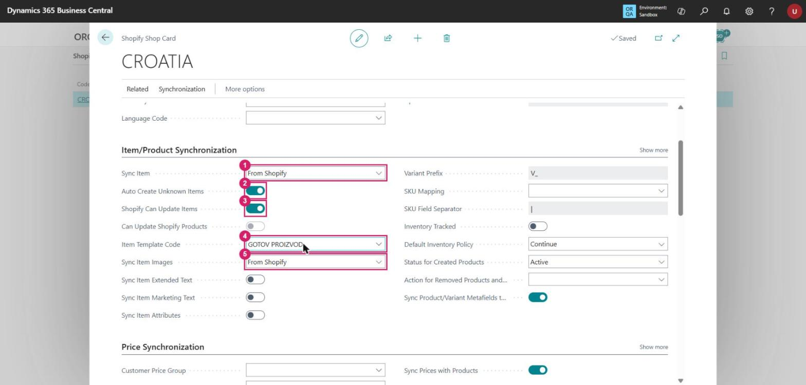

| # | Field | Value |
|---|---|---|
| 1 | Sync Item | From Shopify |
| 2 | Auto Create Unknown Items | On |
| 3 | Shopify Can Update Items | On |
| 4 | Item Template Code | `GOTOV PROIZVOD`. In the test, the field became editable and mandatory once rows 1–3 were set. |
| 5 | Sync Item Images | From Shopify |

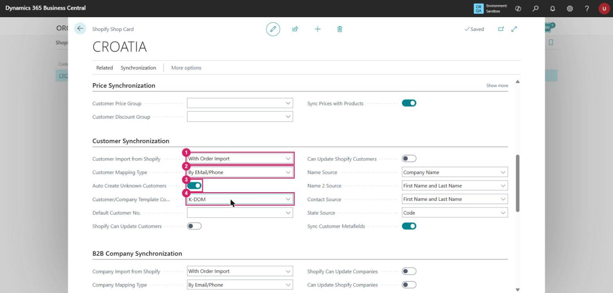

| # | Field | Value |
|---|---|---|
| 1 | Customer Import from Shopify | With Order Import (default) |
| 2 | Customer Mapping Type | By EMail/Phone (default) |
| 3 | Auto Create Unknown Customers | On |
| 4 | Customer/Company Template Code | `K-DOM` |

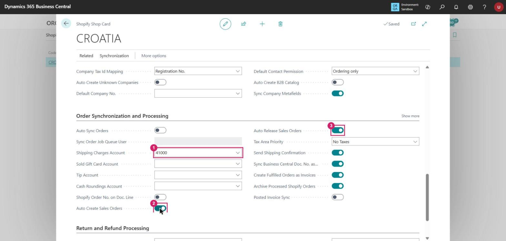

| # | Field | Value |
|---|---|---|
| 1 | Shipping Charges Account | `41000` |
| 2 | Auto Create Sales Orders | On |
| 3 | Auto Release Sales Orders | On (default) |

**Locations.** Open **Related → Locations** and choose **Get Shopify Locations**. The connector reads the store's
locations: here *Shop location* (primary), *My Custom Location* and *Snow City Warehouse* (a fulfillment
service). Choose **Edit List** and map the primary location:

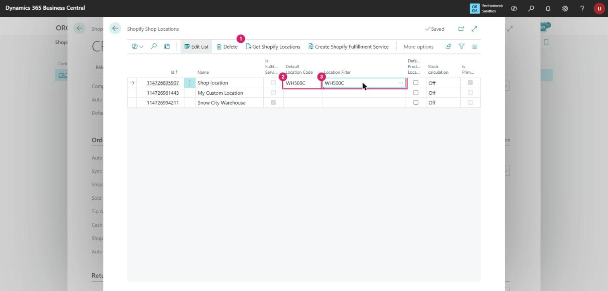

| # | Field | Value |
|---|---|---|
| 1 | **Get Shopify Locations** | Reads the locations from Shopify |
| 2 | Default Location Code | `WH500C`: the location put on order lines |
| 3 | Location Filter | `WH500C`: the location(s) whose stock is counted for Shopify |

**First product import.** The dev store already contains Shopify's demo products:

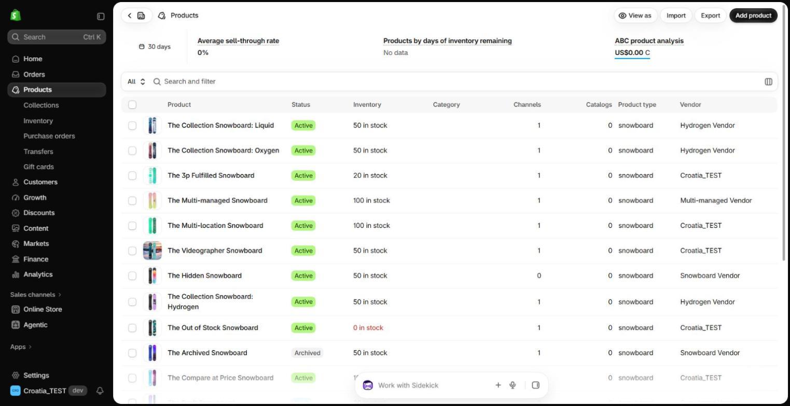

On the Shop card, choose **Synchronization → Sync Products**. With *Sync Item = From Shopify*, BC imports
them (16 in this store) and creates items from the item template:

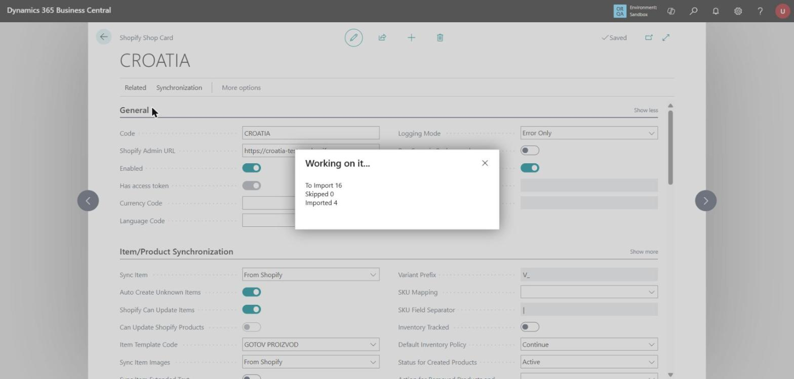

---

# Part 3 — Test an order end to end

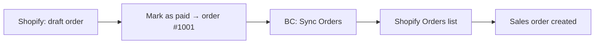

## 3.1 Create a test order in Shopify

In Shopify admin, open **Orders → Drafts → Create order**:

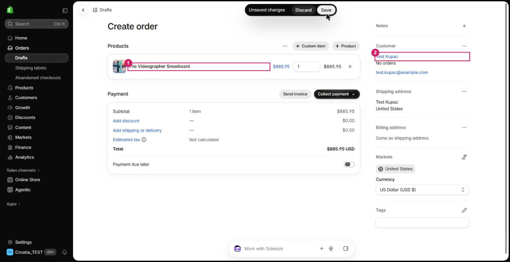

| # | Action |
|---|---|
| 1 | **+ Product**: add a product that was imported in Part 2 (here *The Videographer Snowboard*). |
| 2 | **Customer**: choose *Create a new customer* and use invented data (here *Test Kupac*, `test.kupac@example.com`). |
| — | Then choose **Collect payment → Mark as paid**. |

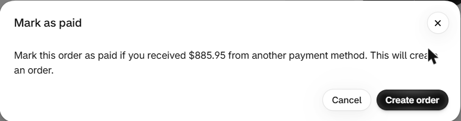

**Create order** turns the draft into a real order. **Mark as paid** records the payment without a payment
gateway, so no card details are needed.

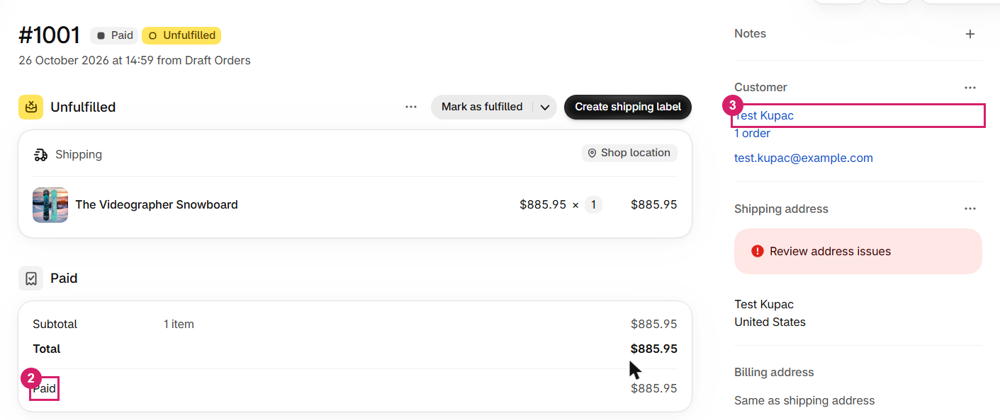

| # | What to check |
|---|---|
| 2 | Payment status **Paid** |
| 3 | Customer **Test Kupac** |

The order number (`#1001` here) is shown at the top.

## 3.2 Import the order into BC

On the Shop card, choose **Synchronization → Sync Orders**, leave the filters as they are (shop `CROATIA`
is prefilled), and choose **OK**. Then search for **Shopify Orders**:

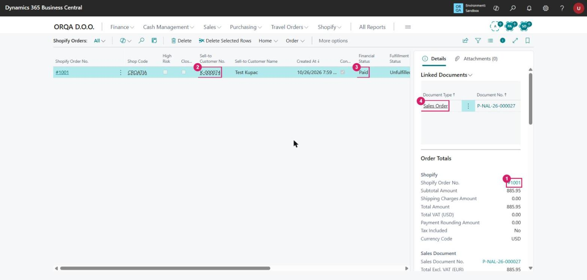

| # | What it shows |
|---|---|
| 1 | Shopify order `#1001` |
| 2 | Customer **K-000074**, created from template `K-DOM` because *Auto Create Unknown Customers* is on |
| 3 | Financial status **Paid** |
| 4 | Linked document: **Sales Order** `P-NAL-26-000027`, created because *Auto Create Sales Orders* is on |

## 3.3 Check the sales order

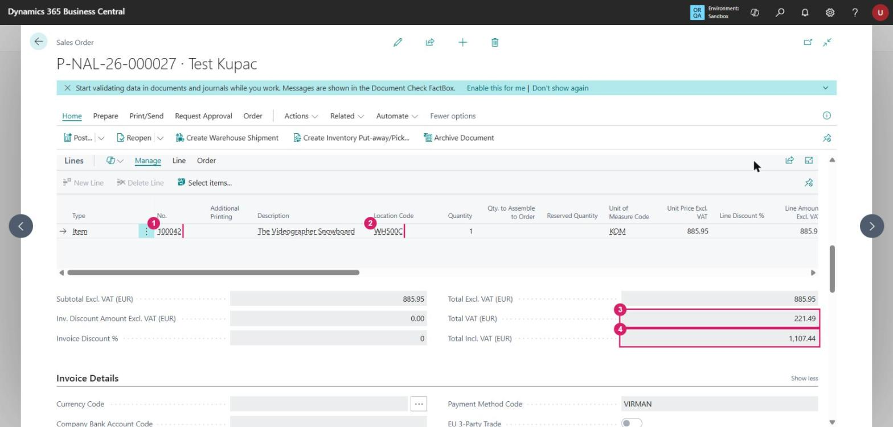

| # | What to check | Result in the test |
|---|---|---|
| 1 | Item | `100042` *The Videographer Snowboard*, the item created by the product import |
| 2 | Location Code | `WH500C`, from the location mapping |
| 3 | Total VAT | **221.49**: BC added 25 % VAT, but the Shopify order had no tax |
| 4 | Total Incl. VAT | **1,107.44**, versus 885.95 paid in Shopify |

The order arrives **released**, because *Auto Release Sales Orders* is on.

## 3.4 What the test showed: fix before go-live

| Finding | Seen in the test | What to do |
|---|---|---|
| **Currency** | The Shopify order is in **USD 885.95**; the BC order shows **885.95 EUR**. The shop's **Currency Code** is blank, and the field's tooltip says to leave it blank only when the store uses the local currency. | Either set the store's currency to EUR in Shopify, or set **Currency Code** = `USD` on the Shop card and maintain USD exchange rates. |
| **VAT** | The BC total (1,107.44) does not match the Shopify total (885.95). The Shopify order had no tax and is not tax-included, and BC calculated 25 % VAT on top. | Decide with the customer whether Shopify prices include VAT, and align Shopify's tax settings and the VAT posting setup that the customer template brings. |
| **Inventory posting** | After the product and order syncs, BC showed *"Inventory Account is missing in Inventory Posting Setup"*. | Complete **Inventory Posting Setup** for location `WH500C` before posting a shipment. |
| **Customer country** | The test customer got Country/Region `US`, because the draft order used Shopify's *United States* market and no address was entered. | Enter a full address on test orders, and set up the store's markets for Croatia. |

---

## Not captured

- **The Shopify app-install screen (step 2).** It opens in a separate pop-up window that browser automation
  cannot reach.
- **Posting the sales order.** It was left unposted because the inventory posting setup above is incomplete.
