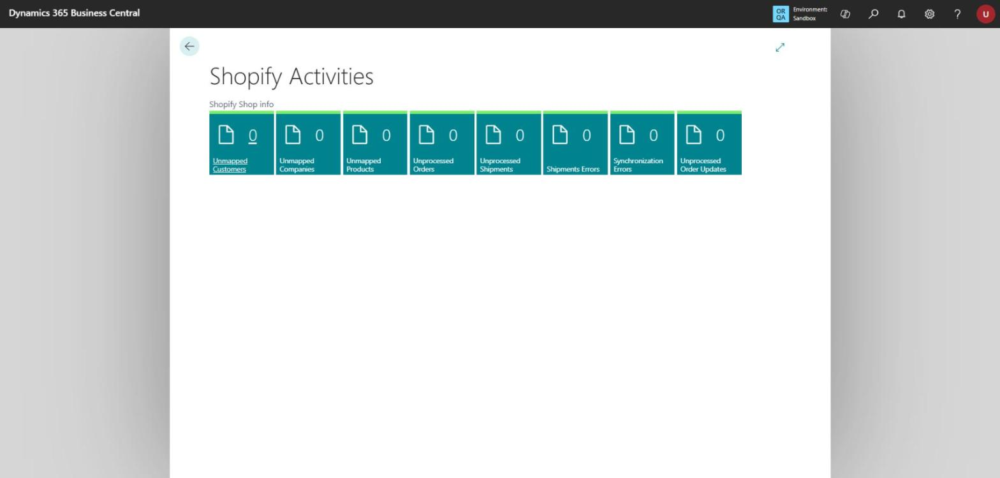
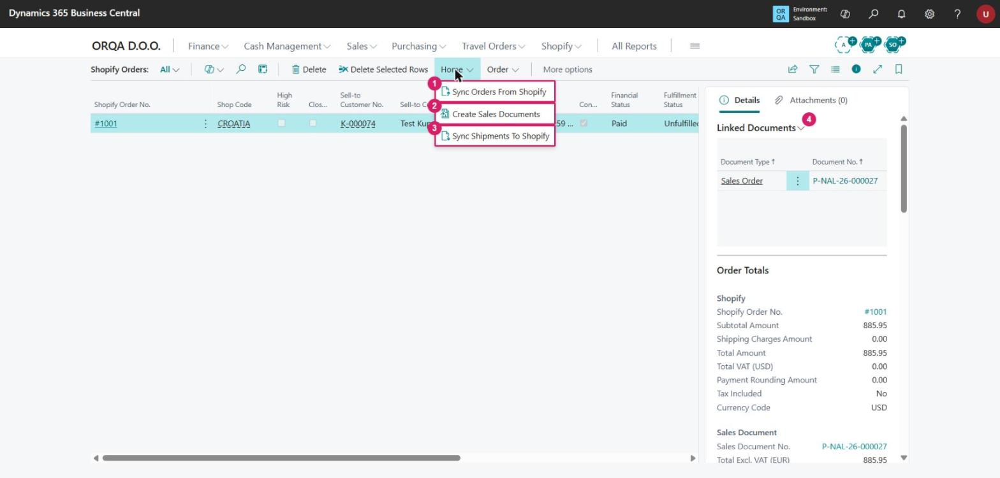
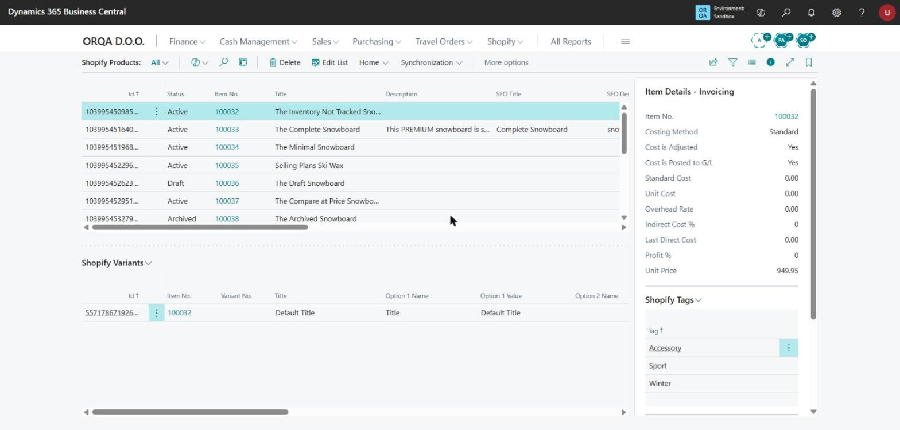

# Shopify Connector — Daily Use Guide for Consultants

How to run the Shopify Connector once it is set up: what to check each day, how orders become sales orders, and
what to do when something does not come through. Setup is in
[shopify-connector-setup-guide.md](shopify-connector-setup-guide.md).

Screenshots come from a BC sandbox (company ORQA D.O.O.) connected to the Shopify dev store
`croatia-test.myshopify.com`. All data in them is demo data; the customer *Test Kupac* is invented.

## The daily routine

```
1. Shopify Activities ──► 2. Sync Orders ──► 3. Create Sales Documents ──► 4. Post / ship in BC ──► 5. Sync Shipments
   (check the cues)          From Shopify       (if not automatic)                                    To Shopify
```

| Step | Where | What you do |
|---|---|---|
| 1 | **Shopify Activities** | Check every cue is 0. A non-zero cue is work for you — click it. |
| 2 | **Shopify Orders** → Home → **Sync Orders From Shopify** | Brings new and changed orders into BC. |
| 3 | **Shopify Orders** → Home → **Create Sales Documents** | Needed only when **Auto Create Orders** is off on the Shop card, or an order failed earlier. |
| 4 | Sales order in BC | Ship and invoice it the normal BC way. |
| 5 | **Shopify Orders** → Home → **Sync Shipments To Shopify** | Sends the posted shipment (and tracking number) back, so the order is fulfilled in Shopify. |

When the job queue runs the synchronizations on a schedule, steps 2, 3 and 5 happen on their own; you then only do
steps 1 and 4.

## 1. Shopify Activities — your work list

Search for **Shopify Activities** (or add the part to your Role Center).



| Cue | Non-zero means | What to do |
|---|---|---|
| **Unmapped Customers** | Shopify customers with no BC customer | Open, then map to an existing customer or create one. |
| **Unmapped Companies** | B2B companies with no BC customer | Same as customers, for B2B. |
| **Unmapped Products** | Shopify products with no BC item | Open, then **Map Product** or **Create Item** (Shopify Products page). |
| **Unprocessed Orders** | Imported orders with no sales document yet | Open, fix the error on the order, then **Create Sales Document**. |
| **Unprocessed Shipments** | Posted shipments not yet sent to Shopify | Run **Sync Shipments To Shopify**. |
| **Shipments Errors** | Shipments Shopify rejected | Open the shipment, read the error, fix, sync again. |
| **Synchronization Errors** | A sync run failed | Open **Shopify Log Entries** (see §5). |
| **Unprocessed Order Updates** | An order changed in Shopify after BC created its sales document | Open the order, compare, then **Mark Conflict as Resolved**. |

## 2. Shopify Orders — from order to sales order

Search for **Shopify Orders**.



| # | Action / part | Use it to |
|---|---|---|
| 1 | **Sync Orders From Shopify** | Import new orders now instead of waiting for the job queue. |
| 2 | **Create Sales Documents** | Create sales orders (or invoices) for the selected orders. |
| 3 | **Sync Shipments To Shopify** | Send posted shipments back to Shopify. |
| 4 | **Linked Documents** (fact box) | See which BC document the order became; click to open it. |

Columns worth adding to the view: **Has Error** and **Error Message** — an order that did not become a sales
document says why here.

### On one order (open it from the list)

| Action | When |
|---|---|
| **Find Mappings** | After you fixed a customer or item mapping: re-checks the order lines and the customer. |
| **Create Sales Document** | Create the sales document for this one order. |
| **Create New Customer** | The customer is not in BC and the Shop card does not create customers on its own. |
| **Mark as Paid** | Payment was collected outside Shopify — marks the order paid in Shopify. |
| **Cancel Order** | Cancels the order in Shopify. |
| **Unlink Processed Documents** | Unlinks the order from its BC sales document (for example before creating it again). |
| **Mark Conflict as Resolved** | After you checked an order that changed in Shopify (cue **Unprocessed Order Updates**). |
| **Sync order from Shopify** | Re-read this one order from Shopify. |
| **Transactions**, **Shipping Costs**, **Fulfillment Orders**, **Refunds**, **Returns**, **Tax Lines** | Look at what Shopify sent — use them to explain a difference in amounts. |

**Check every new order against Shopify once:** the total, the tax and the currency on the order card (fact box
*Order Totals*) against the sales order. The test in the setup guide (Part 3, §3.4) found differences in all three
when the Shop card's **Currency Code** and VAT settings were not set.

## 3. Shopify Products — what is linked to what

Search for **Shopify Products**.



- Each row is a Shopify product; **Item No.** is its BC item. An empty Item No. is an unmapped product.
- **Shopify Variants** (bottom) lists the variants; each one maps to an item or item variant.
- The **Map Product** and **Create Item** actions fix an unmapped product.
- **Synchronization** menu: sync **Products**, **Prices to Shopify**, **Product Images**, **Inventory**.
- **Status** comes from Shopify: *Draft* and *Archived* products are imported but not sold.

## 4. When an order does not become a sales order

| Symptom | Likely cause | Fix |
|---|---|---|
| Order in **Shopify Orders**, **Has Error** = Yes | Customer or item not found | Read **Error Message**; map the customer / product, then **Find Mappings** → **Create Sales Document**. |
| Order is not in **Shopify Orders** at all | Not synced yet | Run **Sync Orders From Shopify**; if it still is missing, check **Shopify Log Entries** (§5). |
| Error about posting setup on the sales order (e.g. *Inventory Account is missing in Inventory Posting Setup*) | BC setup for the location in the locations mapping | Fix the posting setup for that location — a BC setup task, not a connector one. |
| Amounts differ from Shopify | Shop card **Currency Code** blank, or VAT / tax settings | Setup guide §3.4. |
| Order changed in Shopify after the sales order was made | Cue **Unprocessed Order Updates** | Compare, update the sales order by hand, **Mark Conflict as Resolved**. |
| Shipment not fulfilled in Shopify | Shipment not posted, or not synced | Post the shipment; **Sync Shipments To Shopify**; check **Shipments Errors**. |

## 5. Shopify Log Entries and Skipped Records

- **Shopify Log Entries** shows each call to Shopify: URL, **Request Preview**, **Response Preview**, **Has Error**.
  What it records depends on **Logging Mode** on the Shop card:
  - **Error Only** (the default) — only failed calls. An empty log then means nothing failed.
  - **All** — every call. Use it while you diagnose a problem, then switch back: the log grows fast.
  - **Disabled** — nothing, and Skipped Records are not written either.
- Clean up with the actions that delete entries older than 7 days, or all entries.
- **Shopify Skipped Records** lists records a sync left out on purpose, with the reason (for example an item that is
  blocked). Read it when a product, customer or order is missing and Log Entries shows no error.

## 6. Before you hand over to the customer

- Shop card **Currency Code** set to the store's currency (when it differs from the BC local currency).
- VAT / tax settings checked against a real order (setup guide §3.4).
- Posting setup complete for every location in the locations mapping.
- Job queue entries for the syncs running, and someone owns the **Shopify Activities** cues.
